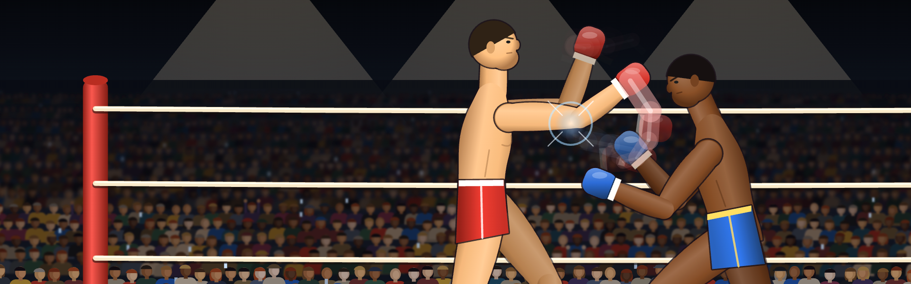
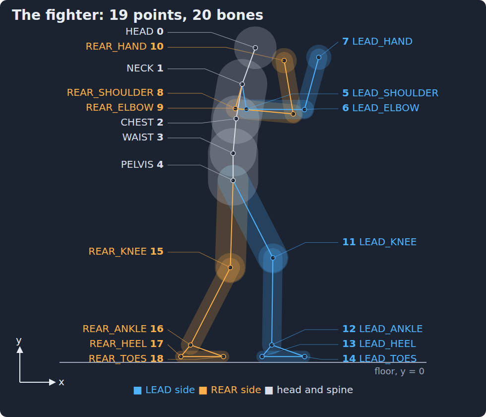

# Byte Club



*The first rule of Byte Club: you code your fighter, joint by joint.*

Byte Club is a bot programming game for [CodinGame](https://www.codingame.com). Two fighters face each other in a ring, seen from the side. Each one is a physical body of 19 points moved by 15 joint motors. Your bot drives one of them: land strikes, keep your balance, stay in the ring.

This repository holds the whole game: the referee, the physics engine, the viewer, the statements and the bosses.

## Leagues

| League | What your bot can do |
|---|---|
| 1 | The 12 ready-made moves: STANCE, GUARD, RELAX, DUCK, JAB, CROSS, OVERHAND, KICK, HIGH_KICK, STEP_FORWARD, STEP_BACK, JUMP |
| 2 | `JOINTS`: set the target angle and the strength of each of the 15 joints yourself |
| 3 | Stamina: every tensed muscle costs stamina, every hit you take drains it, and a tired fighter is weaker |

The full rules are in the statement: [`config/statement_en.html.tpl`](config/statement_en.html.tpl) (French: [`config/statement_fr.html.tpl`](config/statement_fr.html.tpl)).



## Simulating a turn exactly

The input your bot reads each turn is the whole state of the match. A copy of the engine, rebuilt from that input and given both fighters' commands, computes exactly the input of the next turn:

```java
Game copy = Game.fromInput(initLine, linesOfThisTurn, staminaOn, jointsOn);   // you are fighter 0, on the left, as the input shows it
copy.apply(0, myCommand);
copy.apply(1, opponentCommand);     // the opponent's command you predict
copy.simulate();                    // copy.inputLines(0) is now exactly what you will read next turn
```

[`starter/Player.java`](starter/Player.java) is a player ready to paste in the IDE: one file with the four engine classes without their comments (about 69,000 characters, under the 100,000 of the IDE). Each turn it rebuilds the match from the input, tries each named move 4 turns ahead on a copy and plays the best one. It is an example of how to simulate, not a strong player. Set its `LEAGUE` constant to the league being played: the input does not give it.

The engine is four classes in [`src/main/java/com/codingame/game/engine`](src/main/java/com/codingame/game/engine):
- `Physics`: the bodies, the motors, the contacts and the strikes;
- `Game`: the turn, the legs the engine runs, falls and stamina;
- `Moves`: the tables of the named moves;
- `Command`: the parser of a bot's line.

A physics step uses only additions, subtractions, multiplications, divisions and square roots (`atan2` is written with them) on 64-bit floating-point numbers, so a port gives the same numbers in every language.

## Running it locally

You need Java 17 and Maven.

```sh
mvn compile test-compile
mvn dependency:build-classpath -Dmdep.outputFile=cp.txt
java -cp target/test-classes:target/classes:$(cat cp.txt) Main Mixed Boxer 3 7 1800
```

Then open http://localhost:8888/test.html. The arguments are: two bench bots, the league (1 to 3), a seed and the starting distance in mm.

## The test bench

[`src/test/java/arena`](src/test/java/arena) holds bench bots and checks:
- **bots**: `Bots.java` has 13 bots that use the named moves; `Searcher.java` is a search bot that drives the joints;
- **checks**: run `java -cp target/test-classes:target/classes arena.Tests MODE`, with MODE one of:

| Mode | What it checks |
|---|---|
| `check 3` | a copy rebuilt from the input predicts every turn exactly |
| `mirror 3` | a match and its mirror image play the same |
| `fuzz` | what the referee does with each kind of invalid output |
| `look` | the `LOOK` command, which never costs the match |
| `strike` | what each strike does against each held pose |
| `falls 2 Flailer` | every fall of 132 bench matches, sorted by cause |
| `tour N` | a tournament between the bench bots |
